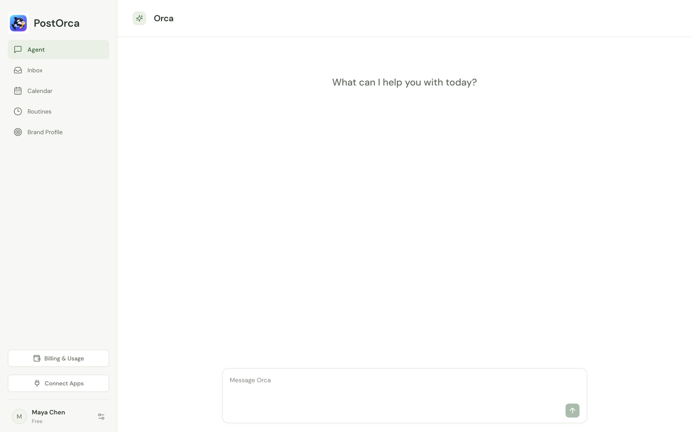
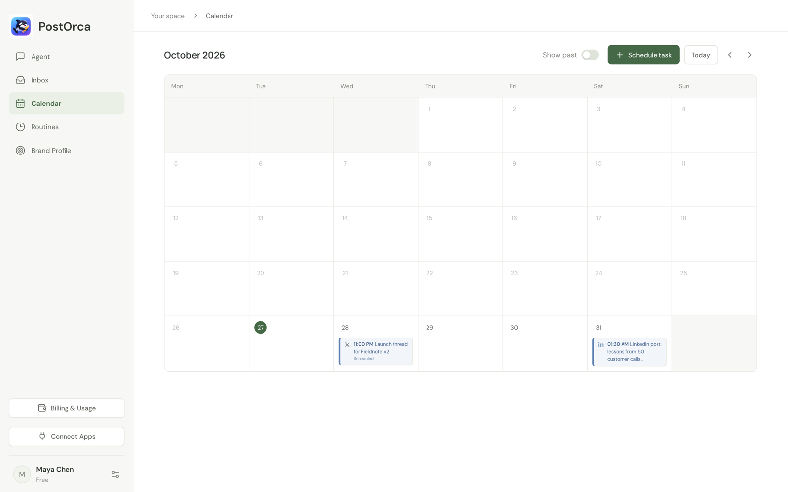
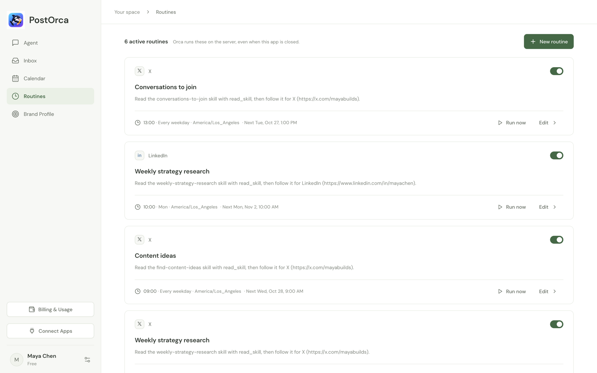
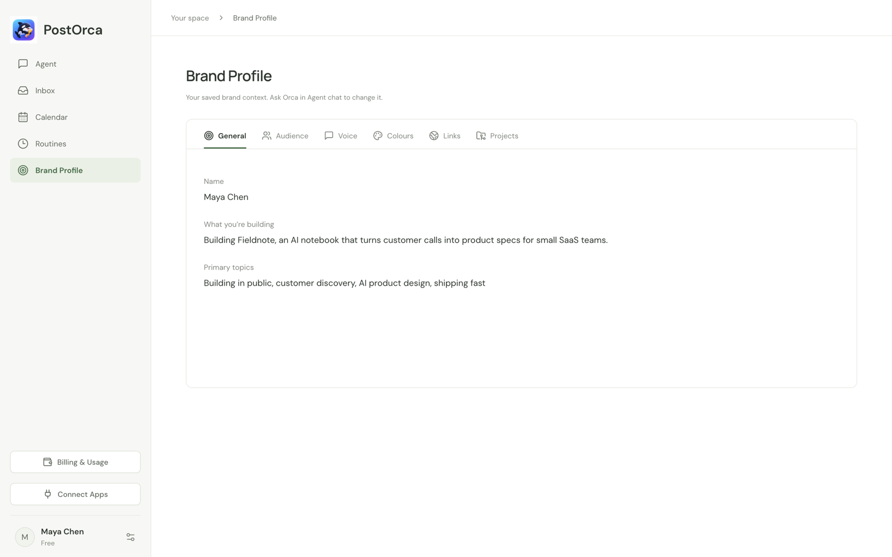

# PostOrca

**A personal brand agent for builders.**

PostOrca is a desktop app with an AI agent, Orca, that helps founders and builders grow their personal brand while they keep building. Orca learns your brand (what you're building, your audience, your voice), then researches ideas, finds conversations to join, and drafts posts, images, audio and video for X, LinkedIn, Threads, Instagram and Facebook. Work runs on a schedule in the background and lands in your Inbox for review.

## Preview

| Agent chat | Calendar |
| --- | --- |
|  |  |

| Routines | Brand Profile |
| --- | --- |
|  |  |

## Features

- **Agent**: chat with Orca, who onboards you, edits your Brand Profile and does work on request.
- **Inbox**: review, edit, approve or follow up on everything Orca produces.
- **Calendar**: schedule one-time tasks.
- **Routines**: recurring work such as daily content ideas and weekly strategy research. They run on the server even when the app is closed.
- **Brand Profile**: your audience, voice, colours, social links and project folders.
- **Tools**: browser control through your own browser, computer use on macOS and Windows, media creation (images, voice, music, video), and Gmail/Google Drive connectors.

## Project structure

| Path | What it is |
| --- | --- |
| [`apps/desktop`](apps/desktop) | Electron + React + TypeScript desktop app |
| [`apps/api`](apps/api) | Express API, Orca's agent loop, tools, skills and scheduler (PostgreSQL) |
| [`apps/connectors`](apps/connectors) | MCP service for Gmail and Google Drive tools |
| [`apps/browser-extension`](apps/browser-extension) | Chrome/Edge/Brave extension that lets Orca work in your browser |
| [`apps/website`](apps/website) | Next.js marketing site |

## Getting started

Requires Node.js 22.12+ and npm 11.

```sh
npm install
cp apps/api/.env.example apps/api/.env
```

In `apps/api/.env`, set `JWT_SECRET` to a random string of at least 32 characters, and add `META_MODEL_API_KEY` to turn Orca, image generation and transcription on. Models are chosen in `apps/api/src/settings.ts`; keys never choose a model. `ELEVENLABS_API_KEY` provides speech, music, sound effects and the video's separate word-timed caption transcription. `.env` holds secrets and values that differ between environments (URLs, client IDs, price IDs); settings that are the same everywhere, like models and welcome credits, live in `apps/api/src/settings.ts`.

`media_transcribe` defaults to Meta (`muse-voice-transcribe-1.0`). Meta takes only WAV, so this needs the desktop app, which converts the audio; the API server does no media conversion. To switch it back to ElevenLabs, set `transcription: { provider: "elevenlabs", model: "scribe_v2" }` in that same settings file and provide `ELEVENLABS_API_KEY`. Failed paid requests do not automatically fall back to another provider. Meta transcription converts saved audio or public HTTPS audio to temporary mono PCM WAV and supports recordings up to 10 minutes / 32 MB. Its results contain turn timings rather than word timings.

Then start each of these in its own terminal:

```sh
npm run db:local
```

```sh
npm run db:migrate && npm run api:dev
```

```sh
npm run dev
```

`db:local` runs a project-local PostgreSQL (no install needed); to use your own database, set `DATABASE_URL` and skip it. The API runs on `http://127.0.0.1:3001` and `npm run dev` opens the desktop app.

To let Orca use your browser, open `chrome://extensions`, turn on Developer mode, choose **Load unpacked** and select `apps/browser-extension`.

## Credits and plans

AI usage is paid for in credits. One credit buys $0.04 of real provider cost (25 credits per dollar). Every model, image and audio request records its actual USD cost; when a request settles, the whole Orca turn it belongs to is charged its total cost in credits, rounded up once to a whole credit. Requests made outside a turn are rounded on their own.

| Plan | Price | Credits | Part of the price spent on AI usage |
| --- | --- | --- | --- |
| Builder | $29 / month | 500 each paid month | $20 |
| Influencer | $69 / month | 1,500 each paid month | $60 |
| Extra credits | $20 once | 500 | $20 |

On the plans, the rest of the price covers servers, payment fees and running PostOrca; Extra credits put the whole price into AI usage. New accounts receive welcome credits once (`apps/api/src/settings.ts`). Unused credits roll over. Upgrading charges the new plan in full and starts a new month with its credits; downgrading applies at the next renewal. Rates and plans live in `apps/api/src/billing/terms.ts`; Stripe runs in test mode.

Developers can integrate their own agents or desktop software with the extension by implementing its local bridge protocol. See the [Browser Bridge developer guide](docs/browser-bridge.md). Third-party integrations require development and setup; existing agents do not connect automatically.

## Scripts

| Command | Description |
| --- | --- |
| `npm test` | Run all tests |
| `npm run check` | Type-check every workspace |
| `npm run eval -- list` | List the shared external agent evals; see [the runner guide](docs/EVAL_RUNNER.md) |
| `npm run build` | Build every workspace |
| `npm run desktop:package` | Build the macOS installer |
| `npm run connectors:start` | Start the Gmail/Drive connector service |
| `npm run web:dev` | Start the website at `http://127.0.0.1:3000` |
| `npm run credits:add -- <email> <credits>` | Add credits to an account, e.g. a local test account |

Deployment is covered in [DEPLOY.md](DEPLOY.md).

## Contributing

We work on `develop` and release to `main`. See [docs/GIT_WORKFLOW.md](docs/GIT_WORKFLOW.md) for branching, pull requests and releases.
