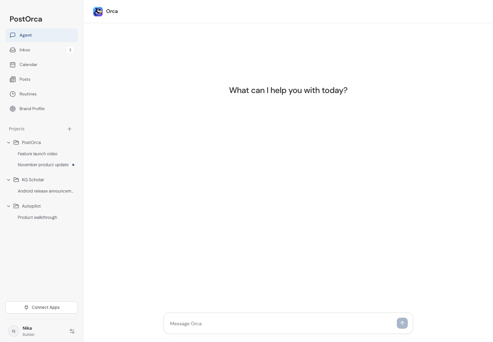
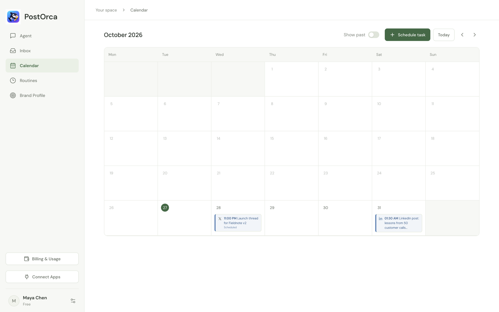
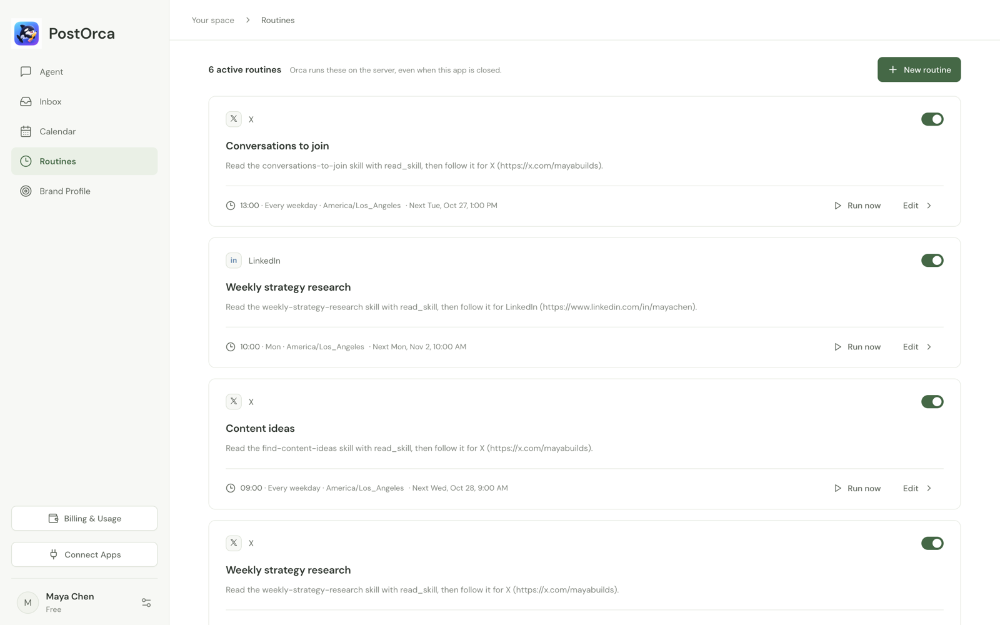
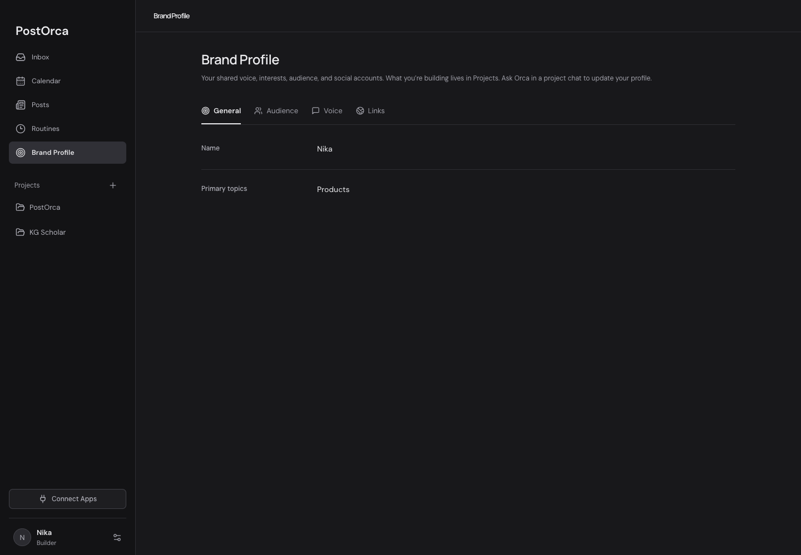

# PostOrca

**From your code to launch videos. You ship it. Orca shows it.**

PostOrca is a desktop app with an AI agent, Orca, that turns what you build into product content: launch videos, feature announcements, how-tos and what's-new round-ups. Orca reads your project and recent commits, opens the running app (a web app, a Mac app or an iPhone app in the Simulator) and writes a plan and a shot-by-shot script. Once you approve it, Orca records your real app and edits the video, with voiceover and captions, for X, LinkedIn, Instagram and more. The plan, script, recordings and video for each piece of content land in one folder.

## Preview

| Project chat | Calendar |
| --- | --- |
|  |  |

| Routines | Brand Profile |
| --- | --- |
|  |  |

## Features

- **Product content**: ask for a launch video, a feature announcement, a how-to or a what's-new round-up. Orca plans it from your code, you approve the script, and Orca records and edits the video.
- **Project chats**: talk to Orca in a separate conversation for each product. Orca reads that project’s source folders and does the work you request.
- **Inbox**: review, edit, approve or follow up on everything Orca produces.
- **Calendar**: schedule one-time tasks.
- **Routines**: work Orca does for you every day on its own, like checking what changed in your projects or how your posts did.
- **Projects**: products you create content for, each with one or more local source folders and its own content tasks. Click a project in the sidebar to open its own Orca conversation. The project name appears in the chat header; its settings gear opens a dialog for folders, name, description, and removal. Work delegated from the conversation automatically stays with that project.
- **Brand Profile**: your shared audience, voice, content interests and social links. Product context comes from Projects.
- **Working folder**: the writable folder Orca uses for generated plans, scripts, recordings and exports. Choose it during setup and change it in Settings → General.
- **Source folders**: read-only inputs for Orca's file tools. They must be separate from the working folder, including parent/child overlaps and symlink aliases. Sources are registered in PostgreSQL (`brand_projects.folders`); the working folder remains local in the app profile's `settings.json` (`workingFolder`). Roles are derived from those stores, not per-folder database flags. The agent sees source paths and their role in its project context, and discovers the local working path and role through `desktop_status`. File-tool write checks enforce this separation; general computer automation is not an OS-level filesystem sandbox.
- **Tools**: browser control through your own browser, computer use on macOS and Windows, media creation (images, voice, music, video), and Gmail/Google Drive connectors.

## Project structure

| Path | What it is |
| --- | --- |
| [`apps/desktop`](apps/desktop) | Electron + React + TypeScript desktop app |
| [`apps/api`](apps/api) | Express API, Orca's agent loop, tools, skills and scheduler (PostgreSQL) |
| [`apps/connectors`](apps/connectors) | MCP service for Gmail and Google Drive tools |
| [`apps/browser-extension`](apps/browser-extension) | Chrome/Edge/Brave extension that lets Orca work in your browser |
| [`apps/website`](apps/website) | Next.js marketing site |

## Getting started

There are two ways to try PostOrca.

### Option 1: download the Mac app

The quickest way. Download the latest `.dmg` from [Releases](https://github.com/nla-asia/postorca-app/releases/latest) (macOS on Apple Silicon), open it and drag PostOrca to Applications. The app connects to the hosted PostOrca server, so there is nothing else to set up. Create an account in the app; every new account gets 250 welcome credits.

### Option 2: run it from source

#### Requirements

- macOS on Apple Silicon. Development and testing happen on macOS; the Windows computer-use code path exists but is not tested.
- Node.js 22.12+ and npm 11
- Xcode Command Line Tools (`xcode-select --install`). The desktop app compiles a small Swift helper for computer use the first time Orca uses it.
- A [Meta Model API](https://dev.meta.ai/docs) key. Orca, image generation and transcription all run on it.
- An [ElevenLabs](https://elevenlabs.io) key, for videos with voiceover, music and captions.
- Optional: Google Chrome, Edge or Brave, so Orca can use your browser.

You don't need a separate database: `npm run db:local` runs PostgreSQL from inside the project.

#### 1. Install and configure

```sh
git clone https://github.com/nla-asia/postorca-app.git
cd postorca-app
npm install
cp apps/api/.env.example apps/api/.env
```

Edit `apps/api/.env`:

| Variable | Needed? | What it does |
| --- | --- | --- |
| `JWT_SECRET` | Required | Any random string of at least 32 characters, e.g. from `openssl rand -base64 32` |
| `META_MODEL_API_KEY` | Required | Turns on Orca (chat and agent), image generation and transcription |
| `ELEVENLABS_API_KEY` | For videos | Voiceover, music, sound effects and word-timed captions |
| `STRIPE_*` | Optional | Buying plans and credits (test mode). Locally, add credits with `npm run credits:add` instead |
| `GOOGLE_*`, `CONNECTOR_ENCRYPTION_KEY`, `MCP_CONNECTOR_*` | Optional | Gmail and Google Drive connectors |
| `OPENAI_API_KEY`, `OPENAI_IMAGE_API_KEY` | Not used by default | Only needed if `apps/api/src/settings.ts` is switched to OpenAI |

Leave `DATABASE_URL`, `PORT` and `CLIENT_ORIGINS` as they are, since they already match the local setup. The desktop app talks to `http://127.0.0.1:3001/api` by default; `apps/desktop/.env.example` shows how to point it somewhere else.

#### 2. Start it

Start each of these in its own terminal, in this order:

```sh
npm run db:local
```

```sh
npm run db:migrate && npm run api:dev
```

```sh
npm run dev
```

`db:local` starts PostgreSQL on port 55433 and keeps its data inside the project. To use your own database, set `DATABASE_URL` and skip it. The API runs on `http://127.0.0.1:3001`, and `npm run dev` opens the desktop app (its renderer runs on port 5173).

#### 3. Sign up and try it

1. In the desktop app, choose **Sign up** and create an account. Any email and password work: the account lives only in your local database, and no email is sent.
2. Go through setup. Pick a **working folder**, where Orca saves plans, scripts, recordings and videos.
3. Add a **project** and give it the source folder of an app you've built. Orca only reads source folders.
4. Open the project's chat and ask, for example, *"Make a 30-second launch video for this app."* Orca reads the code, asks what it needs to know, and writes a plan and a script for you to approve. Then it opens the app, records it and edits the video.

New accounts start with 250 credits. To add more to a local account:

```sh
npm run credits:add -- you@example.com 1000
```

#### 4. macOS permissions

The first time Orca records the screen or controls an app, macOS asks for **Screen Recording** and **Accessibility** access. When running from source, macOS shows the request for Electron, or for the terminal you started it from. Grant the access in System Settings → Privacy & Security, then restart `npm run dev`.

#### 5. Optional: let Orca use your browser

Open `chrome://extensions`, turn on Developer mode, choose **Load unpacked** and select `apps/browser-extension`.

#### Troubleshooting

- **Port already in use**: something else is on 55433 (database), 3001 (API) or 5173 (desktop renderer). Stop it, or change `DATABASE_URL` / `PORT` in `apps/api/.env`.
- **Orca doesn't reply**: if the API terminal says `Orca is off`, set `META_MODEL_API_KEY` in `apps/api/.env` and restart `npm run api:dev`. Provider errors also show in that terminal.
- **Orca stops for lack of credits**: run `npm run credits:add` as shown above.

#### Notes on models and storage

Models are chosen in `apps/api/src/settings.ts`, never by which keys are present. `.env` holds secrets and values that differ between environments (URLs, client IDs, price IDs); settings that are the same everywhere, like models and welcome credits, live in `settings.ts`.

`media_transcribe` defaults to Meta (`muse-voice-transcribe-1.0`). Meta takes only WAV, so this needs the desktop app, which converts the audio; the API server does no media conversion. To switch back to ElevenLabs, set `transcription: { provider: "elevenlabs", model: "scribe_v2" }` in `settings.ts` and provide `ELEVENLABS_API_KEY`. Failed paid requests do not fall back to another provider automatically. Meta transcription converts saved audio or public HTTPS audio to temporary mono PCM WAV and supports recordings up to 10 minutes / 32 MB. Its results contain turn timings rather than word timings.

The desktop app keeps login tokens in `session.json` inside its local user-data profile, with owner-only file permissions (`0600`). It doesn't use Keychain or `safeStorage`. Existing encrypted `session.bin` logins need one new sign-in, which replaces the old file. Logging out removes both session files.

## Credits and plans

AI usage is paid for in credits. One credit buys $0.04 of real provider cost (25 credits per dollar). Every model, image and audio request records its actual USD cost; when a request settles, the whole Orca turn it belongs to is charged its total cost in credits, rounded up once to a whole credit. Requests made outside a turn are rounded on their own.

| Plan | Price | Credits | Part of the price spent on AI usage |
| --- | --- | --- | --- |
| Builder | $29 / month | 500 each paid month | $20 |
| Influencer | $69 / month | 1,500 each paid month | $60 |
| Extra credits | $20 once | 500 | $20 |

On the plans, the rest of the price covers servers, payment fees and running PostOrca; Extra credits put the whole price into AI usage. New accounts receive welcome credits once (`apps/api/src/settings.ts`). Unused credits roll over. Upgrading charges the new plan in full and starts a new month with its credits; downgrading applies at the next renewal. Rates and plans live in `apps/api/src/billing/terms.ts`; Stripe runs in test mode.

Developers can integrate their own agents or desktop software with the extension by implementing its local bridge protocol. See the [Browser Bridge developer guide](docs/browser-bridge.md). Third-party integrations require development and setup; existing agents do not connect automatically.

## Scripts

| Command | Description |
| --- | --- |
| `npm test` | Run all tests |
| `npm run check` | Type-check every workspace |
| `npm run eval -- list` | List the shared external agent evals; see [the runner guide](docs/EVAL_RUNNER.md) |
| `npm run build` | Build every workspace |
| `npm run desktop:package` | Build the macOS installer |
| `npm run connectors:start` | Start the Gmail/Drive connector service |
| `npm run web:dev` | Start the website at `http://127.0.0.1:3000` |
| `npm run credits:add -- <email> <credits>` | Add credits to an account, e.g. a local test account |

Deployment is covered in [DEPLOY.md](DEPLOY.md).

## Contributing

We work on `develop` and release to `main`. See [docs/GIT_WORKFLOW.md](docs/GIT_WORKFLOW.md) for branching, pull requests and releases.
